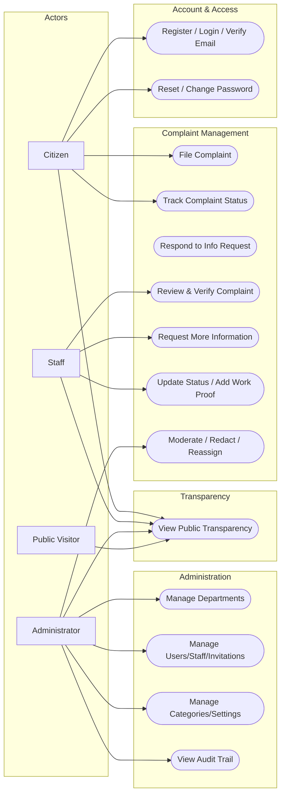
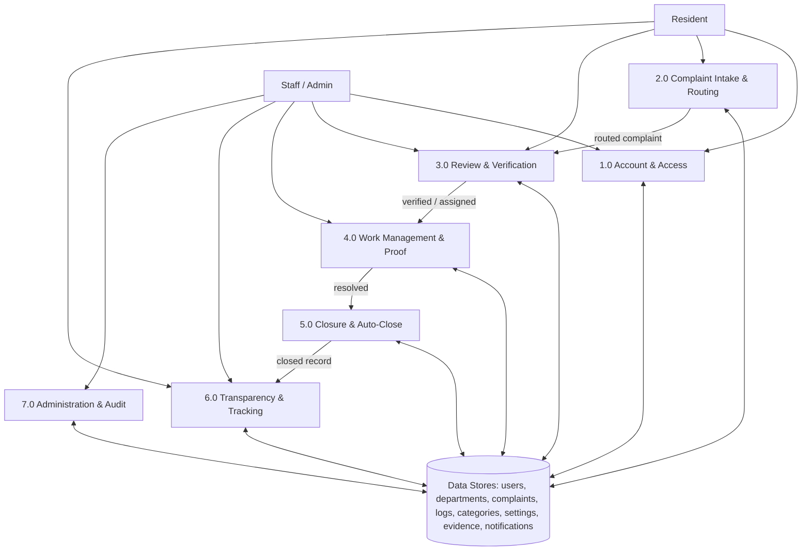
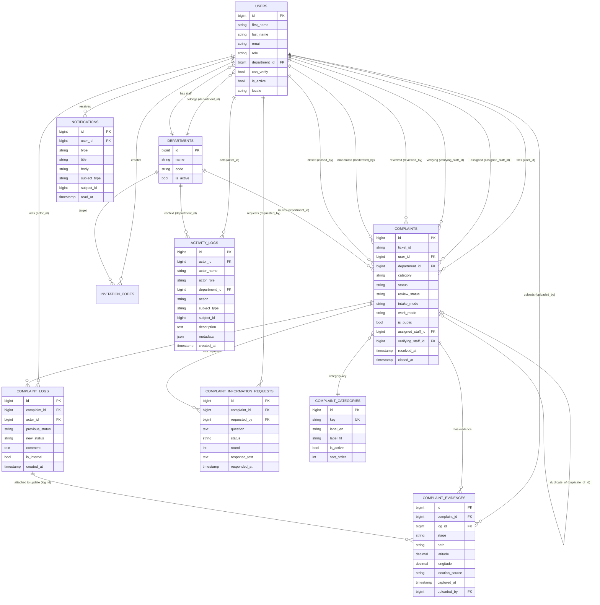
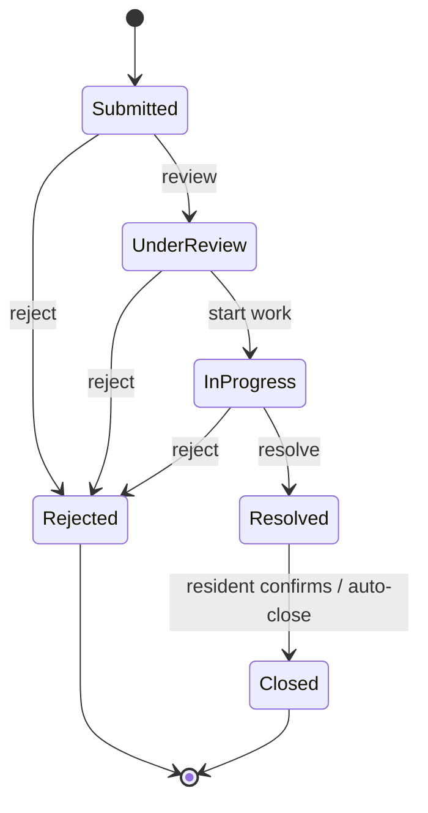

# Daet Listens — Technical Background of the Proposed System (Research Paper Draft)

**System:** Daet Listens — Daet Public Service Complaint & Transparency Management System  
**Domain:** Web-based municipal complaint intake, routing, tracking, remediation evidence, and public transparency  
**Stack (actual):** Laravel 12 · PHP 8.5 · PostgreSQL 17 · Redis · MinIO · Tailwind v4/Vite · Livewire 4 · Blade · Leaflet  
**Pilot deployment:** Tailscale Funnel (public HTTPS) over Docker Compose services (host networking)  
**Status:** Living draft — replace `[to confirm/fill]` with measured/final values before submission.

---

## 1. Technical Background of the Project

### Design of Software, System, Product, or Process

#### Conceptual Design of the Proposed System

**Table 1. System context and actors**

| Element | Description |
|---|---|
| System | **Daet Listens** — web-based complaint, routing, tracking, remediation-evidence, and public-transparency system for the Municipality of Daet, Camarines Norte. |
| Primary goal | Enable residents to file and track municipal concerns; enable LGU offices to review, route, act on, and evidence resolution; provide barangay-level public transparency with privacy safeguards. |
| Actor: Citizen (Resident) | Registers/verifies account, files complaints, tracks status/ticket, responds to information requests, sets visibility intent (subject to policy/review for sensitive cases), views public transparency. |
| Actor: Staff | Department-scoped user; reviews/verifies complaints (if `can_verify`), requests information, updates status, records actions/proof (photos/notes/referrals per work mode), moderates/redacts where authorized. |
| Actor: Administrator | Manages departments, users/staff, invitations, categories/settings, oversees all complaints/queues, reassignment, audit trail, system configuration. |
| Actor: System (automated) | Routes complaints by category, enforces validation/policy, logs immutable audit records, sends notifications/emails (OTP/reset/updates), flags SLA/stale/auto-close conditions, serves public transparency feed. |
| External services (pilot) | Brevo (transactional email API, mailer fallback), Tailscale Funnel (public HTTPS access), browser geolocation/map (Leaflet). |
| Core constraints | Privacy-first public data (barangay-level, no PII), role/capability-based access, immutable auditability, i18n (English/Filipino), configurable to department processes. |

**Table 2. Conceptual modules**

| Module | Purpose | Key functions (conceptual) |
|---|---|---|
| Account & Access | Identity, roles, verification | Registration/login, email OTP verification, password reset/change, forced temp-password change, role/capability enforcement (admin/staff/citizen, `can_verify`). |
| Complaint Intake | Capture resident concerns | Guided filing (category, details, evidence/location per policy), jurisdiction/boundary checks, ticket generation, auto-routing to department. |
| Review & Verification | Validate legitimacy/completeness | Triage/review statuses, verification, information requests to resident, delegation, duplicate/spam/moderation signals. |
| Work Management & Proof | Act on and evidence resolution | Status workflow, work/proof modes (labor/report/referral), staff updates, evidence attachments, SLA/overdue/stale handling, closure/auto-close. |
| Transparency & Tracking | Accountability and visibility | Resident “My Complaints”/tracking, public transparency register & detail (barangay-level, redacted/moderated), publication controls. |
| Administration | Governance and configuration | Departments, users/staff, invitations, complaint oversight/reassignment/export, audit trail, system/category settings. |
| Notification & Communication | Keep actors informed | In-app notifications, email delivery (OTP/reset/invitation/ticket updates). |
| Audit & Logging | Traceability | Immutable per-complaint logs and cross-cutting activity logs (who/what/when/department/metadata). |

---

#### Logical Design of the Proposed System

**Table 3. Logical data entities (core)**

| Entity | Key attributes (logical) | Relationships / purpose |
|---|---|---|
| `users` | id, name, email, role (citizen/staff/admin), `department_id` (staff), `can_verify`, `is_active`, locale/preferences, verification/password flags | Files complaints (citizen); acts on complaints (staff/admin); belongs to a department (staff). |
| `departments` | id, name, code, active/archived state | Receives/routes complaints; groups staff; routing target. |
| `complaints` | id, `ticket_id`, `user_id`, `department_id`, category, title/description, status, `review_status`, priority, intake/work mode, location (lat/lng/barangay/address), visibility/publication & moderation fields, timestamps (resolved/closed/verified) | Central case record; owned by citizen; routed to department; has logs, evidence, info requests, notifications. |
| `complaint_logs` | id, `complaint_id`, `actor_id`, previous/new status, comment/note, internal flag, timestamps | Immutable per-complaint status/action timeline. |
| `complaint_evidences` | id, `complaint_id`, `log_id`, stage, path, caption, latitude/longitude, location_source, captured_at, `uploaded_by` | One row per proof photo; satellite of complaint_logs (stage: verification/work_start/completion/supporting). |
| `complaint_information_requests` | id, `complaint_id`, `requested_by`, question, status, round, response_text, response_image_paths, responded_at, resolved_at | Verification loop between staff and resident. |
| `complaint_categories` | key, `label_en`, `label_fil`, active, sort/group (current); planned: routing/requirement/privacy profile bindings | Category definitions/labels (current) → target for admin-configurable behavior (planned). |
| `activity_logs` | actor snapshot, role, `department_id`, action, subject, description, metadata, ip/user-agent, timestamp | Immutable cross-cutting audit trail (append-only). |
| `notifications` | id, `user_id`, type, title, body, subject_type/id, context, read_at, timestamps | In-app attention feed. |
| `invitation_codes` | code/token, invitee details, department/role intent, expiry/use state, creator | Staff onboarding/invitation flow. |
| `email_verification_codes` | user/email, code/hash, purpose, expiry/consumption | Email OTP verification. |
| `system_settings` | key/value (and related config records) | System-wide configurable settings. |

**Table 4. Logical process flows (summary)**

| Process | Flow (logical) |
|---|---|
| Complaint filing & routing | Citizen selects category → system resolves intake policy & destination department → citizen submits required info/evidence → complaint created (ticket), moderated/scored, routed → logged/audited. |
| Review & verification | Staff/admin triages (review status) → verify / request more info (resident responds) / reject/escalate/mark duplicate → state & actions logged. |
| Work, proof & resolution | Staff acts per work mode (labor/report/referral) with required proof/record → status progresses (Submitted/Under Review/In Progress/Resolved/Rejected/Closed) per allowed transitions → resolution notified. |
| Closure | Resident confirms closure, or system auto-closes after grace period post-resolution (per rule) → logged. |
| Transparency publication | Eligible, non-sensitive/public-safe records exposed at barangay-level with redaction/withholding; sensitive/review-gated cases require review before any public display. |
| Audit | Every significant action writes immutable complaint/activity log entries with actor/department/time/context. |

**Table 5. Suggested diagrams to include (logical/physical)**

| Diagram | What to show | Source basis in project |
|---|---|---|
| Use Case Diagram | Actors (Citizen, Staff, Admin, System/Services) vs modules (file, track, review, work/proof, transparency, admin, audit). | Roles, routes, controllers/policies. |
| Context (DFD Level 0) | Daet Listens as process; external entities (Resident, Staff/Admin, Brevo, Tailscale/public users, storage). | Architecture/services above. |
| DFD Level 1 / Activity Flows | Filing→routing→review→work→closure; transparency publication; verification/info-request loop. | Complaint/review/work services & statuses. |
| ERD (Logical/Physical) | Entities in Table 3 with PK/FK and cardinalities. | Migrations/models. |
| Deployment/Architecture Diagram | Client ↔ HTTPS (Tailscale Funnel) ↔ Laravel app ↔ PostgreSQL/Redis/MinIO/Mailpit/Brevo. | `compose.yaml`, `TAILSCALE_DEPLOYMENT.md`, config. |
| State Diagram | `ComplaintStatus` transitions (Submitted→Under Review→In Progress→Resolved→Closed; Rejected terminal) + review states. | `App\Enums\ComplaintStatus`, workflow. |

---

#### Physical Design of the Proposed System

##### Architecture Design

**Table 6. Software architecture (layered)**

| Layer | Technology / components | Responsibility |
|---|---|---|
| Presentation | Blade views, Tailwind v4 + custom CSS/tokens, vanilla JS, Livewire 4 (transparency), Vite-built assets, bundled Leaflet | UI rendering, responsive/accessible pages, maps, soft navigation, live queue/ticket updates. |
| Application | Laravel 12 (Controllers, Middleware, Form Requests/validation, Policies, Services, Enums, Notifications, Console Commands) | Business rules: routing, intake/work policies, review/verification, moderation, SLA, notifications, audit logging. |
| Domain/Data | Eloquent models, PostgreSQL schema/migrations, enums/status machines | Persistent entities, relationships, integrity, frozen per-ticket modes. |
| Integration/Infrastructure | Redis (cache/session/queue), MinIO (S3 storage), Brevo/Mailer (email), Mailpit (dev), Tailscale Funnel (pilot ingress) | Caching/sessions, object storage, outbound comms, public access. |

##### Hardware Infrastructure Setup

**Table 7. Pilot hardware/infrastructure setup**

| Item | Pilot (current) | Recommended production [to plan] |
|---|---|---|
| Host | Developer/operator machine running Docker services + Laravel app **[specify CPU/RAM/disk]** | LGU-managed server or VPS/cloud instance with defined sizing. |
| Availability | Dependent on host uptime/power/network and Tailscale service | Managed, always-on hosting with SLA/monitoring. |
| Storage | Local/container volumes for DB and MinIO objects **[specify]** | Managed disk/object storage with backup policy. |
| Backups/DR | **[to confirm/document]** (not a managed production backup) | Scheduled DB/object backups, restore testing, DR plan. |

##### Network Connectivity Design

**Table 8. Network/connectivity (pilot)**

| Path | Protocol/port (typical) | Description |
|---|---|---|
| User ↔ Public endpoint | HTTPS 443 | Residents/staff/admin access via Tailscale Funnel public URL. |
| Funnel ↔ App host | Tailscale tunnel → local/bound HTTP (e.g. app port 8000) | Ingress proxy to application. |
| App ↔ PostgreSQL | TCP 5432 | Database queries. |
| App ↔ Redis | TCP 6379 | Cache/session/queue. |
| App ↔ MinIO | TCP 9000 (API) / 8900 (console, admin) | Object storage (S3 API). |
| App ↔ Mailpit (dev) | SMTP 1025 / UI 8025 | Local email capture. |
| App ↔ Brevo | HTTPS 443 (outbound API) | Transactional email delivery. |
| Deployment mode | Docker Compose, `network_mode: host` (per project) | Services bound on host interfaces as configured. |

##### Minimum Hardware, Software, and Network Requirements

**Table 9. Minimum requirements (proposed/baseline — [to validate by load testing])**

| Category | Minimum (proposed) | Recommended (pilot/small office) | Notes |
|---|---|---|---|
| **Server hardware** | 2 vCPU, 4 GB RAM, 40 GB storage | 2–4 vCPU, 8 GB RAM, 80+ GB SSD | Hosts PHP app + Docker services (pgsql/redis/minio). Size up with users/files. **[validate]** |
| **Client hardware** | Smartphone or PC, 2 GB RAM, modern browser | Mid-range smartphone/PC, updated browser | Responsive web UI. |
| **Server software** | Linux (x86_64), Docker Engine + Compose, PHP 8.5, Composer, Node.js/npm (build), Git | Same + process manager/reverse proxy for production (Nginx/Apache + PHP-FPM) | Matches project stack. |
| **Application stack** | Laravel 12, PostgreSQL 17, Redis, MinIO, Vite/Tailwind build toolchain | Same; Mailpit (dev) or Brevo/SMTP (prod mail) | As per codebase. |
| **Client software** | Modern browser (Chrome/Edge/Firefox/Safari, current), JS enabled | Same | Required for map/wizard/dynamic UI. |
| **Network** | Stable internet; HTTPS access to app; outbound HTTPS for Brevo (if used) | ≥ 5–10 Mbps up/down for host; low-latency LAN/Internet for users **[validate]** | Pilot via Tailscale Funnel; production needs domain/DNS + TLS. |

---

### Development and Testing (if applicable)

**Table 10. Development and testing summary**

| Aspect | Description |
|---|---|
| Development approach | Iterative/incremental implementation over Laravel MVC + service-layer patterns; config/DB-driven policies; versioned migrations/seeders. |
| Environment | Docker Compose services (pgsql, redis, mailpit, minio); local app run; Vite dev/build; environment-configured secrets/keys (`.env`, not committed). |
| Languages/frameworks | PHP 8.5/Laravel 12, Blade/Livewire 4, JavaScript, Tailwind CSS v4/CSS, SQL (PostgreSQL). |
| Testing types | Automated **feature tests** (PHPUnit 11) covering routing, auth/verification, complaint workflows, review/verification, SLA, notifications, localization, permissions, UI/overflow/guard checks, etc. (≈50 feature test classes in repo). |
| Quality/guardrails | Design-system guard, localization parity checks, immutable audit logging, validation/policy enforcement, soft-navigation patterns. |
| Known baseline | Some pre-existing baseline test failures noted in project records **[state current count/result at submission time]**. |
| Tools | PHPUnit, Laravel Pint, Composer/npm scripts, Git/GitHub. |

---

### Description of the Prototype (if applicable)

**Table 11. Prototype description**

| Item | Description |
|---|---|
| Prototype name | **Daet Listens** web application (functional pilot prototype). |
| Scope implemented | End-to-end flow: resident registration/verification → complaint filing (category-based intake, location/evidence as applicable) → auto-routing → staff/admin review, verification, work/proof, status updates → resident tracking/closure → public transparency register/detail (barangay-level, privacy-controlled) → admin management & audit trail. |
| Users/roles supported | Citizen, Staff (with verification capability), Administrator. |
| Key characteristics | Ticket-based tracking, immutable audit logs, i18n (en/fil), map/geolocation support, moderation/redaction, in-app + email notifications, SLA/auto-close automation. |
| Deployment form (prototype) | Web app accessible via **Tailscale Funnel** public HTTPS (pilot); Docker-backed services. |
| Out of scope / evolving | Fully data-driven admin-configurable categories/routing/required-info (planned), full production hardening (managed hosting/domain/DR/SLA) — **[update to match final state]**. |

---

### Implementation Plan (Infrastructure/Deployment, if applicable)

**Table 12. Implementation/deployment plan**

| Phase | Activities | Output/criteria | Status [update] |
|---|---|---|---|
| 1. Environment & infrastructure | Provision host; run Docker Compose (PostgreSQL, Redis, MinIO, Mailpit); configure `.env`, storage, mail. | Services healthy; app connects to DB/cache/storage. | Done (pilot) |
| 2. Application build & configuration | Install dependencies, run migrations/seeders, build frontend assets (Vite), configure roles/departments/categories, set keys (Brevo etc.). | Deployable build; baseline data loaded. | Done (pilot) |
| 3. Pilot deployment (interim) | Expose app via Tailscale Funnel (HTTPS), verify public/resident/staff/admin flows and file uploads. | Accessible pilot URL for testing/demo. | Done (pilot) |
| 4. Testing & evaluation | Execute feature tests; conduct functional/UAT and resident/staff feedback (incl. survey insights e.g. category gaps like water). | Test results, issue list, improvement backlog. | Ongoing **[confirm]** |
| 5. Enhancement (planned) | Implement admin-configurable categories/routing/required-info/privacy profiles; add missing categories (e.g. water→OM referral); reseed demo data. | Data-driven, customizable intake/routing/workflow. | Planned |
| 6. Production hardening (target) | Move to managed hosting/LGU server, proper web server (Nginx/Apache + PHP-FPM), official domain+TLS, backups/monitoring, security hardening, ops handover. | Production-ready, maintainable deployment. | Future **[budget/domain dependent]** |

---

### Implementation Results (if applicable)

**Table 13. Implementation results (pilot — [fill with your measured outcomes])**

| Area | Result / evidence | Remarks |
|---|---|---|
| Functional implementation | Core modules operational in pilot: auth/verification, filing & routing, staff/admin workflows, tracking, transparency, notifications, audit. | Based on implemented features/routes/tests. |
| Pilot accessibility | System publicly reachable for demo/testing via Tailscale Funnel HTTPS endpoint. | Interim, host/Tailscale-dependent availability. |
| Automated testing | PHPUnit feature suite executed; **[insert pass/fail counts, date]**. | Note any known baseline failures. |
| User/survey findings | Resident demand identified for **water** complaints not covered by a dedicated category (fell to “Others”) — informing configurable-category redesign. | Drives planned enhancement. |
| Performance/usability/security | **[insert UAT results, response times, usability findings, security checks]** | Collect during evaluation. |
| Limitations observed | Pilot infra limits (non-branded URL, host-dependent uptime, no managed backups/DR, not production-tuned). | Addressed in production-hardening plan. |

---

## 2. Diagrams (Mermaid — renders in GitHub/Markdown viewers; export to images for paper)

> The following are ready-to-render Mermaid diagrams. In a Markdown viewer that supports Mermaid they render visually; otherwise paste into https://mermaid.live to export PNG/SVG for your paper.

### 2.1 Use Case Diagram



### 2.2 Context Diagram (DFD Level 0)

```mermaid
flowchart TD
  R[Resident] -->|complaint data, evidence, responses| DL[Daet Listens System]
  DL -->|status, ticket, notifications| R
  ST[Staff / Admin] -->|review, actions, assignments, config| DL
  DL -->|queues, reports, audit| ST
  DL -->|emails: OTP, reset, updates| BR[Brevo / Mailer]
  BR -->|delivery status| DL
  DL -->|files (evidence/proof)| MS[MinIO Storage]
  MS -->|file bytes| DL
  DL -->|queries / updates| DB[(PostgreSQL)]
  DB -->|data| DL
  DL -->|public transparency data| PUB[Public Visitors]
  PUB -->|view requests| DL
  TS[Tailscale Funnel] -.->|HTTPS ingress (pilot)| DL
```

### 2.3 DFD Level 1 (Process Decomposition)



### 2.4 Entity-Relationship Diagram (ERD)



### 2.5 Complaint Status State Diagram



### 2.6 Deployment / Architecture Diagram (Pilot)

```mermaid
flowchart LR
  subgraph Client
    B[Browser (Mobile/Desktop)]
  end
  subgraph PilotIngress
    TF[Tailscale Funnel (HTTPS 443)]
  end
  subgraph Host
    APP[Laravel App (PHP 8.5)]
    subgraph DockerServices
      PG[(PostgreSQL 17)]
      RD[(Redis)]
      MN[(MinIO S3)]
      MP[(Mailpit (dev))]
    end
  end
  subgraph External
    BR[Brevo (Email API)]
    GEO[Browser Geolocation/Maps]
  end
  B -->|HTTPS| TF
  TF -->|tunnel| APP
  APP --> PG
  APP --> RD
  APP --> MN
  APP --> MP
  APP -->|HTTPS API| BR
  B --> GEO
  B --> APP
```

---

## 3. Notes for Submission

- Replace all **[to confirm/fill/validate]** placeholders with your measured data and final decisions.
- If your institution requires specific diagram notation (e.g., Chen/Crow’s Foot ERD, formal DFD symbols), redraw the Mermaid diagrams above in your tool of choice using the same entities/processes.
- For the **planned enhancement** (admin-configurable categories/routing/required-info), keep the paper’s *Implementation Plan/Results* aligned with what is actually delivered at submission time; update Table 12/13 accordingly.
- Privacy statement to retain in the paper: public transparency is **barangay-level only**, areas with under 3 reports are **neutralized**, and no resident PII (names/contacts) is exposed in the public payload; sensitive cases are review-gated and may be redacted/withheld.
- i18n: system supports **English** and **Filipino**; department names are not translated (proper names), process wording is.

---

*Generated from the Daet Listens codebase and planning discussion. Diagrams are provided as Mermaid source for export to image formats suitable for academic submission.*